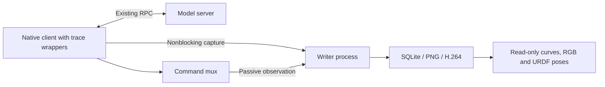

The independent `tools/phyai_debug` launcher wraps the native Tianji client.
The original `run_remote()` still owns warmup, control activation, scheduling and shutdown.
Recording currently supports `StopAndRefill`; scoped probes reject unreviewed implementation changes before connecting.



## Prepare and inspect

Use the existing robot Python environment with NumPy, Pillow, PyYAML, OmegaConf,
pyzmq and the native ROS/PyAV dependencies. Keep the model environment separate.

```bash
export PYTHONPATH="$PWD:$PWD/phyai-robot/src${PYTHONPATH:+:$PYTHONPATH}"
npm --prefix tools/phyai_debug/web ci
npm --prefix tools/phyai_debug/web run build
python -m tools.phyai_debug demo --output .cache/debug-demo
python -m tools.phyai_debug view .cache/debug-demo --port 8770
```

Demo data is synthetic. Neither command connects to ROS or a model server.
Add `--robot-assets /path/to/console/assets` to `demo` to snapshot an existing
`robot.urdf` and referenced package meshes for 3D inspection.

## Record

Use `tools/phyai_debug/examples/trace.yaml` as the trace configuration.
Robot topics, calibration and timing stay in the existing client YAML.

```bash
python -m tools.phyai_debug check \
  --client-config /path/to/model/tianji_client.yaml \
  --trace-config ./debug.yaml
```

`check` does not create ROS nodes or send RPC. After the existing server is ready,
run this command only during a supervised robot experiment:

```bash
python -m tools.phyai_debug run \
  --client-config /path/to/model/tianji_client.yaml \
  --trace-config ./debug.yaml \
  --output ./traces/test-001
```

**`run` enables real robot control after the native warmup sequence.** It does not
home the robot or start the model server. Ctrl+C uses native shutdown before
flushing the recorder. Detaching from tmux does not stop control.

## Replay

```bash
python -m tools.phyai_debug view ./traces/test-001 --port 8770
```

The viewer binds to loopback and has no control endpoints. Use SSH forwarding for
remote access. A non-loopback binding exposes trace contents without authentication.

Playback synchronizes exact request RGB, per-joint tracking and error curves,
freshness, request timing and two URDF poses. Blue is feedback; orange is the target.
Select a full prediction chunk and a target index; discarded tails are shaded.
Request images are held until the next request, not presented as continuous video.
Optional compressed packets remain in `video/` with their offset/timestamp events.

Each state source retains its own monotonic callback timestamp. Source ROS
headers remain separate and unknown when absent. The existing freshness gate
runs before inference; observation age at command send is a diagnostic, not a
new control threshold. Policy RPC actions are already server-postprocessed:
the viewer must not add joint deltas again.

The tool records client commands, individual publish outcomes, observed mux output
and DAgger modes separately. A successful publish is not hardware acknowledgement.
Queue overflow or writer failure marks a trace incomplete without blocking control
on disk I/O. CPU tests cannot establish live 200 Hz timing or model success.

The committed `tools/phyai_debug/README.md` contains full configuration and usage;
`tools/phyai_debug/DESIGN.md` documents collection points, identity, clock semantics,
failure behavior and verification requirements.
