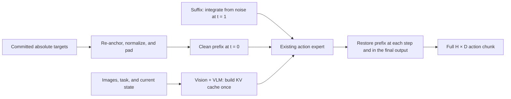
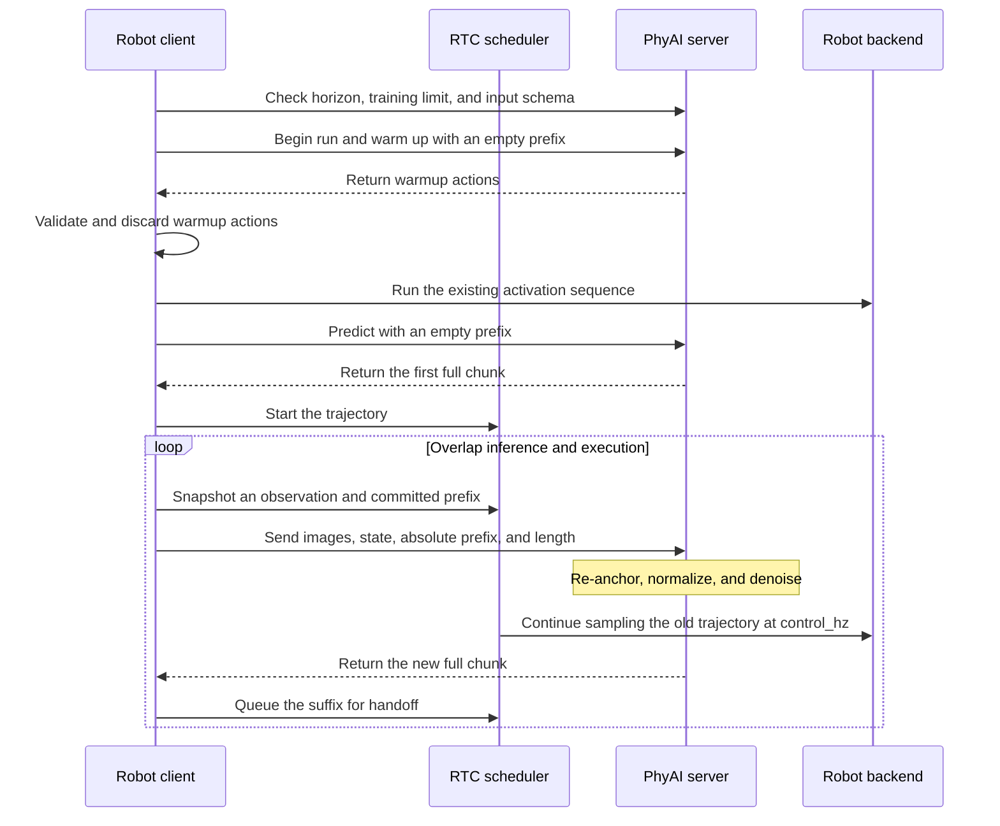

Training-time real-time chunking (RTC) lets the robot continue following its current trajectory while PI0.5 predicts the next chunk. The model conditions the new prediction on actions the controller has already committed to execute. When the prediction arrives, the client joins the new suffix to that prefix. Use a checkpoint trained with prefix conditioning, and keep the action representation and normalization statistics from training.

## From training to inference

LoongForge uses noise time for flow matching:

```text
x(t) = t × noise + (1 − t) × action
```

During training, each sample gets a prefix length drawn from `[0, max_prefix_len]`, inclusive. Prefix tokens receive clean actions at `t = 0`. The suffix keeps its sampled flow-matching time and is the only part included in the loss. Training with `max_prefix_len=0` uses the ordinary PI0.5 path.

During inference, the previous trajectory supplies the prefix. Before each Euler update, the runner restores those positions and uses `t = 0` AdaRMS modulation for their tokens. It restores the prefix again after the final step and returns all `H` action rows.



RTC reuses the existing weights, time MLP, AdaRMS, attention, and output head. No trained parameters, checkpoint tensor names, or tensor shapes change.

Export the training value of `max_prefix_len` in `config.json`. Legacy checkpoints without this field default to `0`. To use a prefix-trained checkpoint with RTC, construct the engine with `PI05Args(enable_rtc=True)` or the model with `PI05Model(config, enable_rtc=True)`. The switch defaults to `False`. Editing the metadata or turning on the switch cannot replace prefix training. Wall loss weighting and the [RL Token sidecar](/models/pi05/rl-token) are independent of RTC.

## Model requests and CUDA Graphs

With RTC enabled, `PI05Request` accepts an optional normalized action prefix and per-sample lengths:

| Field | Shape | Meaning |
| --- | --- | --- |
| `action_prefix` | `[B, P, max_action_dim]` | Prefix normalized using the current observation as the state anchor |
| `prefix_lengths` | `[B]`, integer | Number of valid prefix rows per sample; omit to use all `P` rows |
| Action output | `[B, H, max_action_dim]` | Full chunk, including the preserved prefix |

The request must satisfy `0 ≤ prefix_lengths ≤ P ≤ max_prefix_len < H`. The model rejects nonfinite values, mismatched shapes, and lengths supplied without a prefix tensor.

The runner copies prefix data and masks into fixed-shape buffers. Changing the effective length does not require recapturing a CUDA Graph. The model selects the precomputed `t = 0` modulation for prefix rows; a weight update also rebuilds that modulation table.

RTC with a nonzero effective prefix is supported for deterministic Euler inference only. Stochastic rollout requests with a nonzero prefix are rejected.

## Encode absolute targets in model space

The robot queues absolute targets after output mapping. For example, Tianji's 16-dimensional action order is seven left-arm joints, the left gripper, seven right-arm joints, and the right gripper. For a joint-delta checkpoint, re-anchor each queued target to the state in the new observation:

```text
new_delta[i, joint] = old_absolute_target[i, joint] − current_state[joint]
new_action[i, gripper] = old_absolute_target[i, gripper]
normalized_prefix = checkpoint_action_normalizer(new_action)
```

For example, a `0.3 rad` prediction from a `1.0 rad` joint observation gives a `1.3 rad` absolute target. If the next observation reads `1.1 rad`, the same target becomes a `0.2 rad` delta before normalization. Use the same new observation for all prefix rows and for decoding the returned suffix. Do not copy the previous request's normalized deltas or read another state when the reply arrives.

`PI05Processor.encode_action_prefix` starts in FP32, like the Euler output. It records the state each delta step uses, including any preceding state transforms, and reverses the checkpoint's action postprocessor. It preserves each step's mask, statistics, dtype, and epsilon, then pads the result to model width. State and action widths may differ as long as they satisfy each delta step's mask contract. Absolute-action pipelines have no delta step, so they do not subtract state. For custom steps the processor cannot invert, provide an explicit prefix encoder through the processor factory.

## Robot client and model server



RPC retains its JSON header and NumPy array frames. The server advertises the fixed-shape prefix inputs only when RTC is enabled. Both sides validate observations, prefix inputs, and outputs against the declared schemas. The robot process does not need Torch.

Timing uses the client's monotonic clock, so the server and robot clocks do not need to agree. RTC keeps the existing run reservation, warmup discard, freshness checks, control lateness limit, cancellation, and stop cleanup. It does not eliminate jitter on the Python control thread.

## Hand off to the new suffix

With action frequency `f`, observation anchor `t₀`, and `P` prefix rows, the scheduler samples the old trajectory at:

```text
prefix[i] = old_trajectory(t₀ + i / f), for i = 0 … P−1
handoff = t₀ + (P−1) / f
```

The first prefix row is the interpolated target at the observation anchor, even if it falls between action samples. If the result arrives early, the scheduler holds it until the handoff. It uses the original last prefix target at the join, then interpolates to the first new suffix row at index `P`. This keeps normalization round-trip error from moving the committed join point.

At `25 Hz` with `prefix_steps=8`, prefix rows are 40 ms apart. The first row is at 0 ms, the handoff is at 280 ms, and the first suffix row is at 320 ms. **The inference budget is 280 ms, not 320 ms.** It includes preprocessing, RPC, inference, postprocessing, and client validation. The scheduler must accept the result strictly before the handoff. If it misses the deadline, the client raises a timeout and runs stop cleanup. If fresh observations do not arrive, the client stops when the old trajectory runs out rather than holding the last target indefinitely.

The scheduler holds one active chunk and at most one pending chunk. Set the client and checkpoint values so they satisfy:

```text
2 ≤ prefix_steps ≤ execution_horizon
prefix_steps ≤ trained max_prefix_len < H
execution_horizon + prefix_steps ≤ H
```

There is no adaptive latency estimate or timeout retry. Measure end-to-end request latency before choosing `prefix_steps`. A larger prefix gives inference more time, but leaves fewer suffix rows and delays the effect of a new observation on the robot.

## Configure Tianji

Use a converted prefix-trained checkpoint with `config.json`, weights, a tokenizer, `policy_preprocessor.json`, `policy_postprocessor.json`, and the statistics sidecars referenced by those pipelines. Keep the existing model server and robot client in their separate environments. RTC does not require new ROS topics or another service.

In the model server configuration, enable RTC explicitly:

```yaml
policy:
  enable_rtc: true
  enable_rlt: false
```

RTC and RLT both default to `false` and can be enabled independently. The following client settings assume `chunk_size=50` and a trained `max_prefix_len` of at least `8`:

```yaml
schedule:
  strategy: rtc
  action_hz: 25.0
  execution_horizon: 25
  prefix_steps: 8

control:
  control_hz: 200.0
  max_sample_age_s: 0.5
  max_control_lateness_s: 0.01
```

| Setting | Effect |
| --- | --- |
| `chunk_size` in the checkpoint | Number of rows in each prediction, including the prefix |
| `max_prefix_len` in the checkpoint | Longest prefix seen in training; `0` means no RTC training |
| `policy.enable_rtc` | Enables prefix conditioning and publishes the prefix schema |
| `schedule.prefix_steps` | Number of committed targets, including the target at the observation anchor |
| `schedule.execution_horizon` | Interval between inference anchors, in action periods, when using `rtc` |
| `schedule.action_hz` | Rate at which action rows are played; choose it with the training time spacing in mind |
| `control.control_hz` | Rate at which interpolated targets are published |

With `stop_and_refill`, `execution_horizon` is the number of leading rows to execute before pausing for the next prediction. With `rtc`, it sets when to request an update; the old trajectory keeps playing until the handoff. The client does not replay the new chunk's prefix from the beginning.

Inspect the resolved client configuration without connecting to the robot:

```bash
python -m examples.deployment.tianji \
  --config /path/to/client.yaml \
  --print-config \
  schedule.strategy=rtc \
  schedule.action_hz=25 \
  schedule.execution_horizon=25 \
  schedule.prefix_steps=8
```

Run the server in the model environment:

```bash
python -m examples.deployment.serve_pi05 \
  --config /path/to/server.yaml \
  policy.enable_rtc=true
```

For supervised hardware testing, run the same client command in the robot environment without `--print-config`. It activates control after warmup and validation. Confirm the robot's stop mechanism, configuration, and timing budget first. If you reuse an editable environment from another worktree, check that `phyai`, `phyai_robot`, and `phyai_utils_tools` all import from the intended checkout.

## Implementation and validation

| Layer | Files | Responsibility |
| --- | --- | --- |
| Model configuration and requests | `configuration_pi05.py`, `scheduler_pi05.py` | Validate the training limit and request tensors; maintain the `t = 0` modulation table |
| Model execution | `model_runner_pi05.py` | Hold fixed buffers, select per-token modulation, and restore the prefix |
| Native processor | `processor_pi05.py` | Invert the action pipeline to encode the absolute prefix |
| Server | `examples/deployment/pi05.py` | Advertise and validate schemas, then forward the model request |
| Robot adapter | `adapters.py`, `robots/tianji.py` | Pack committed targets in model order and validate adapter capability |
| Scheduling and handshake | `scheduling.py`, `remote/client.py` | Negotiate RTC support, enforce deadlines, and hand off trajectories |
| Observation snapshot | `robot.py`, `deployment.py` | Capture the observation and prefix under the same robot I/O lock |

CPU tests cover modulation, Euler prefix preservation, the disabled path, processor re-anchoring, RPC schemas, early and late results, interpolation, and cleanup. Offline trained-checkpoint tests cover all four RTC/RLT combinations in eager and CUDA Graph modes, including repeated fixed-noise requests and prefix checks. They did not run a robot or restart a live service. They do not establish full-size parity with the training implementation, end-to-end latency, or hardware task success. Model-level checks remain outside regular CI.
