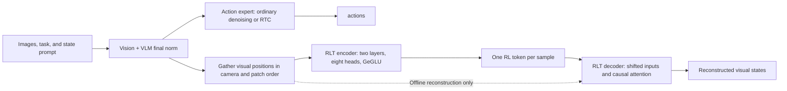

Enable RLT when you construct a PI0.5 model to receive an `rl_token` alongside its action chunk. The token compresses the final VLM visual hidden states, which already incorporate the language and state prompt. PhyAI loads both the encoder and decoder from the checkpoint, but only runs the encoder during action inference.

## Computation path



The scheduler uses the same VLM forward pass for actions and the token. It takes only the final-normalized visual positions: three 224×224 images contribute 256 patch tokens each, for a total of 768. The encoder does not separately consume the language positions.

The encoder adds learned positions to the visual states and appends the learned RL embedding with the **last** entry in the position table. It uses that last position even for shorter visual sequences. Two layers of bidirectional attention produce the RL Token at the appended position, with no extra final norm or feature normalization.

The decoder takes `[RL, z₀, …, zₘ₋₂]` and predicts `[z₀, …, zₘ₋₁]`. Shifting the inputs and using a causal mask prevent it from copying the target at the current position. Mask missing visual positions in place; do not compact or renumber them.

## Configuration and output

Keep the training metadata in the converted checkpoint's `config.json`. For example:

```json
{
  "rlt_mode": "joint",
  "rlt_max_visual_tokens": 768
}
```

`rlt_mode` accepts `off`, `token_only`, or `joint` and records how the checkpoint was trained. To enable RLT, you need `token_only` or `joint` and the complete trained sidecar. To enable [training-time RTC](/deployment/training-time-rtc), you need a trained `max_prefix_len` greater than `0`. The runtime switches are independent and default to `False`; a checkpoint with either feature still works as an action-only model by default.

```python
from phyai.models.pi05.main_pi05 import PI05Args

args = PI05Args(
    checkpoint_dir="/path/to/checkpoint",
    enable_rlt=True,
    enable_rtc=False,
)
```

The same rules apply when you construct `PI05Model(config, enable_rlt=True, enable_rtc=False)` directly. The model keeps the original metadata as `model.checkpoint_config` and exposes the effective runtime configuration as `model.config`. It does not write changes to the checkpoint.

With `serve_pi05.py`, use these settings:

```yaml
policy:
  checkpoint: /path/to/checkpoint
  enable_rlt: true
  enable_rtc: false
```

| `enable_rlt` | `enable_rtc` | Engine return value | Action prefix input |
| --- | --- | --- | --- |
| `false` | `false` | Action tensor | No |
| `false` | `true` | Action tensor | Optional, up to the trained limit |
| `true` | `false` | `PI05Output` | No |
| `true` | `true` | `PI05Output` | Optional, up to the trained limit |

`PI05Output` supports both attribute access and named-tensor mapping access:

```python
result = engine.step(request)
actions = result.actions       # [B, H, max_action_dim]
rl_token = result.rl_token      # [B, 1, text.hidden_size]
assert result["rl_token"] is rl_token
```

Pass only `actions` to the [checkpoint postprocessor](/models/pi05/processors). The token is a representation vector, so it does not go through action unnormalization, delta conversion, or controller routing.

When you enable RLT, `serve_pi05.py` advertises an extra RPC output. The single-request response uses these shapes:

| Field | Shape | Meaning |
| --- | --- | --- |
| `actions` | `[H, action_dim]` | Physical targets after native postprocessing |
| `rl_token` | `[1, text.hidden_size]`, float32 | Representation vector with the request batch dimension removed |

The robot adapter still executes only `actions`. The dedicated action gateway keeps its existing action protocol. Generic named-tensor backends can read both fields of `PI05Output`. RLT does not require changes to ROS topics, control rates, or RTC scheduling.

## Checkpoint conversion and precision

The default LoongForge sidecar has width 2048, two encoder and two decoder layers, eight heads, and an MLP ratio of 4. Its 53 parameter tensors contain 275,920,896 parameters. Preserve the complete `rlt_token.*` namespace, including:

- The learned `rl_token`, `encoder_positions`, and `decoder_positions`.
- LayerNorm, attention, and GeGLU weights and biases for both transformer stacks.
- `output_projection` and the input projection when the widths differ.

LoongForge DCP keys start with `model.rlt_token.*`. When converting to PhyAI safetensors, remove the outer `model.` prefix, add the sidecar shard to the weight index, and retain the training metadata. A conversion that only extracts `model.model.*` drops the sidecar.

The source checkpoint stores packed attention in Q/K/V order and `mlp_in` in value/gate order. PhyAI's loader rearranges the latter to DenseMLP's gate/up order, so do not swap it during export. Load the position parameters from the checkpoint rather than initializing new ones.

When RLT is disabled, PhyAI does not build the sidecar and ignores `rlt_token.*` while applying the usual strict loading rules to the backbone. When RLT is enabled, PhyAI requires the full encoder, decoder, and learned positions even with `weight_strict=False`.

PhyAI keeps the LoongForge sidecar in FP32 even when the backbone uses BF16. The full sidecar weights take about 1.03 GiB. The decoder stays loaded for offline reconstruction checks, but does not run on a normal inference request. The reference comparison uses `encode` and `decode` without training autocast; it does not establish matching rounding or latency under BF16 autocast.

## Implementation and validation

`modeling_rlt_pi05.py` reuses PhyAI's LayerNorm, Linear, DenseMLP, and Attention layers. Masked requests use SDPA so the visual buffer keeps its fixed shape during CUDA Graph capture. `model_runner_rlt_pi05.py` runs the encoder, and `scheduler_pi05.py` extracts visual states and returns actions and tokens that can be retained across requests. You can call `decode(token, features, mask)` separately for offline reconstruction.

CPU reference tests compare a smaller complete sidecar against LoongForge with the same weights and inputs, including position handling, weight layout, masking, causal isolation, and strict loading. Integration checks cover VLM reuse, the default tensor return, combined RTC/RLT, the RPC round trip, and custom postprocessing.

Offline tests with a 2048-wide checkpoint exercised all four RTC/RLT combinations in eager and CUDA Graph modes, checking finite outputs, preserved action prefixes, and repeated requests. These tests do not establish full-size parity with the training implementation. Actor, critic, reward, replay buffer, and online learning are outside the inference integration.
