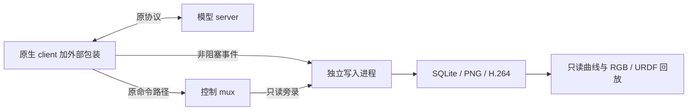

`tools/phyai_debug` 是独立诊断工具。它复用原生 Tianji `run_remote()` 生命周期，
不修改模型 server、RobotDeployment、scheduler 或机器人驱动。
第一版支持 `StopAndRefill`；接口和实现指纹变化时，兼容检查会在连接机器人前拒绝启动。

## 架构与时间语义



记录 request 真正使用的三路 RGB 和 state、每个字段的 callback 时间、读取时间、
freshness 判断、完整 action chunk、裁剪后动作、调度 tick、逐 topic publish、
mux 最终输出、连续反馈和 DAgger 模式切换。

`received_at_ns` 是 client 回调开始时的 monotonic 时间。`source_stamp_ns` 是
消息 header，保留独立时钟域；没有 header 的夹爪反馈不伪造采样时间。
一次 16 维 state 可以包含不同接收时刻的样本。

图中分别显示请求时 age 和实际发送命令时对应 observation 的 age。
原 `max_sample_age_s` 只在推理前判定；执行时 age 曲线不是新增的控制门限。
RPC 输出已是 server 后处理后的目标，查看 joint-delta 模型时不能再次累加 delta。

## 准备

使用现有 robot Python 环境，保留模型 server 的独立环境。无需为了这个工具执行根目录 `uv sync`。
记录器需要 NumPy、Pillow、PyYAML、OmegaConf、pyzmq，以及原 client 已有的 ROS/PyAV 依赖。

```bash
export PYTHONPATH="$PWD:$PWD/phyai-robot/src${PYTHONPATH:+:$PYTHONPATH}"
npm --prefix tools/phyai_debug/web ci
npm --prefix tools/phyai_debug/web run build
python -m tools.phyai_debug --help
```

先用合成数据测试回放；这两个命令不连接机器人：

```bash
python -m tools.phyai_debug demo --output .cache/debug-demo
python -m tools.phyai_debug view .cache/debug-demo --port 8770
```

如果要显示机器人，在 `demo` 后加 `--robot-assets /path/to/console/assets`。
该目录应包含 `robot.urdf` 与引用的 package mesh；资源会快照到 trace，权重不会复制。

## 记录真实实验

复制 `tools/phyai_debug/examples/trace.yaml` 为本地配置。路径相对于该配置文件：

```yaml
output_root: ./traces
queue_capacity: 4096
image_capacity: 64
flush_timeout_s: 30
robot_assets: /path/to/console/assets
model_bundle: /path/to/model
capture_video: true
passive_ros: true
```

`model_bundle` 只保存指定的 JSON/YAML 来源说明，不复制权重。
`capture_video` 保存 client 收到的 H.264 拼图原始包和偏移；网页默认播放精确请求快照。
`passive_ros` 旁录 Tianji 的 mux 最终命令、模式与 DAgger 事件。

先检查配置；此命令不创建 ROS 节点，也不发 RPC：

```bash
python -m tools.phyai_debug check \
  --client-config /path/to/model/tianji_client.yaml \
  --trace-config ./debug.yaml
```

模型 server 就绪、现场有人看护时，在原 robot ROS 环境运行：

```bash
python -m tools.phyai_debug run \
  --client-config /path/to/model/tianji_client.yaml \
  --trace-config ./debug.yaml \
  --output ./traces/test-001
```

**`run` 会经原流程 warmup 后启用机器人控制。** 不自动 home，不启动模型 server。
`Ctrl+C` 先走原 client 的停止与资源清理，再等待记录器有限时间落盘；退出 tmux 不会停止控制。
已有 trace 目录不会覆盖。

## 查看结果

```bash
python -m tools.phyai_debug view ./traces/test-001 --port 8770
```

Viewer 默认监听 loopback。远程使用时，在自己的电脑转发：

```bash
ssh -N -L 8770:127.0.0.1:8770 ROBOT_HOST
```

浏览器打开 `http://127.0.0.1:8770`。播放只改变网页，HTTP 服务没有控制接口。
它没有登录认证；公开监听会暴露 trace 中的图像、状态与配置。

- 播放/暂停、倍速、拖动时间轴和上一/下一 request 联动曲线、RGB、3D。
- RGB 是请求实际用到的像素，按 request 保持，不冒充连续视频。
- 蓝线是反馈，橙线是 client 命令，绿线是 mux 输出，虚线是选中 chunk 的预测。
- 左右臂可切换，关节可单独聚焦；夹爪单独显示 normalized 曲线。
- chunk 视图保留完整 horizon，未执行的尾部有阴影。
- 3D 可选实际下发目标、mux 目标或某个预测 step；预测模式以原请求 state 作对照。
- URDF 离线显示保留越界原值并标注，不悄悄夹紧；当前双臂 URDF 没有可动夹爪。
- freshness 可选择来源；另有执行时 observation age、RPC耗时和实际发送间隔曲线。

原始数组的 dtype、shape 和 bytes 保存在 `trace.sqlite` 的 `arrays` 表。
`events` 表保留事件关联和 JSON，`model_inputs/` 保存 PNG，`video/` 保存可选 H.264，
`robot/` 保存几何快照。`manifest.json` 记录写入完整性与丢弃计数。

## 验证边界

有界队列溢出或记录器失败不会替换控制异常，也不会等待磁盘后才发命令；trace 会标为不完整。
完整落盘不证明 DDS 没有丢包，publish 成功也不证明硬件收到命令。
Header 是否来自硬件采样时刻、真实负载下的 200 Hz 时序和实际成功率需要现场验收。
保持原来的控制迟到阈值，不通过放宽门限掩盖记录开销。

详细接口、事件关联、时钟图与测试范围见仓库内
`tools/phyai_debug/DESIGN.md` 和 `tools/phyai_debug/README.md`。
