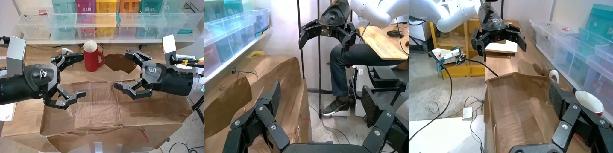

用文字描述机器人工作区。Xiaomi-Robotics-U0-4B 生成视觉 token，PhyAI 将其解码成一张包含多个视角的 RGB 图片。输出尺寸由模型决定。

## 生成场景

按[文生图指南](/zh/models/xiaomi-u0/text-to-image#准备模型)准备环境和权重。然后在 PhyAI 仓库根目录运行以下命令，并指定一个新目录或空目录保存结果。

```bash
PHYAI_FLASHINFER_WORKSPACE_BYTES=1073741824 \
uv run --locked python examples/xiaomi_u0/run_xiaomi_u0.py \
  --checkpoint-dir "$U0_CHECKPOINT" \
  --vision-tokenizer-dir "$U0_VISION_TOKENIZER" \
  --task scene-gen \
  --robot-arm-type "AgiBot G1" \
  --prompt "Workspace: A wooden workbench. Objects: A red mug to the left of a blue tray. Lighting: Soft overhead light. Background: White shelves with clear storage bins." \
  --output-dir ./outputs/u0-scene \
  --seed 42
```

`--robot-arm-type` 指定提示词里的机器人型号，默认为 `AgiBot G1`。在 `--prompt` 中描述工作区、物体位置、光照和背景。

这个样例在单张 CUDA GPU 上运行，为 FlashInfer 分配 1 GiB 工作区，并关闭 CUDA Graph。Scene Gen 默认最多生成 8192 个 token。生成更大的网格时，可能需要调高 `--max-new-tokens` 并使用更多 GPU 内存。

## 查看输出

打开 `outputs/u0-scene/image.png` 查看生成结果。`generation.json` 中的 `stop_reason=image_end` 表示模型生成到了图像结束标记。`image_grid_shape` 记录视觉 token 网格的高和宽，`image_size` 记录解码后图片的宽和高。

样例还会保存 `generated_ids.npy`、`input_ids.npy`、`unconditional_ids.npy` 和 `tokenizer_mapping.json`。如果只想检查输入 token，可以加上 `--prepare-only` 并使用另一个空输出目录，此时无需加载模型。

## Thor 样例

在 NVIDIA Jetson Thor 上使用 FlashInfer 和 seed 42 运行上面的提示词，生成以 `image_end` 结束，输出了一张 2048 × 512 的 RGB PNG。


