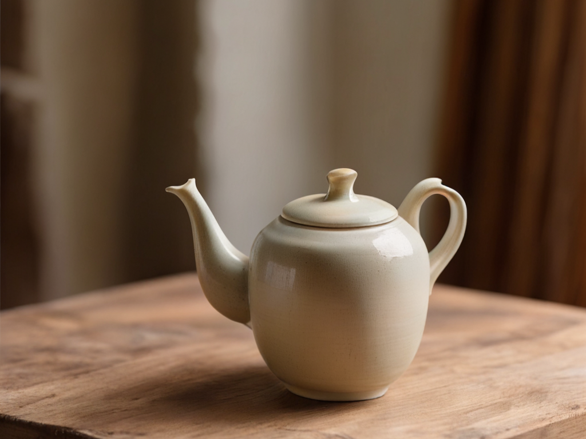
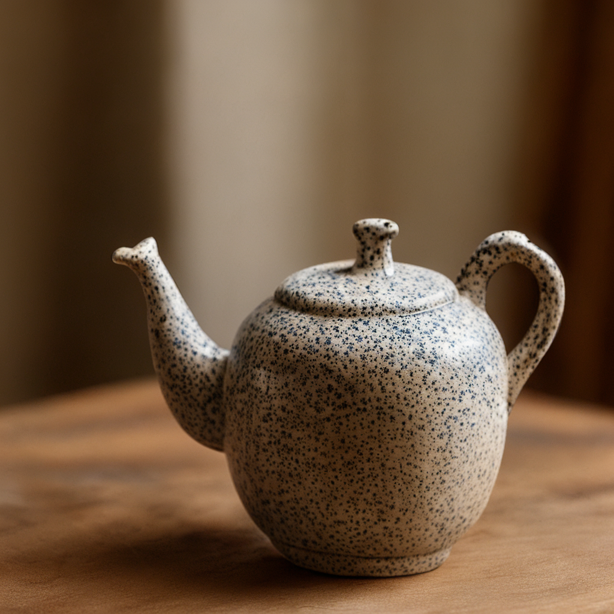

# Xiaomi U0 image generation and editing

Generate a 1024 × 1024 image from text, or edit one reference image with a text instruction. PhyAI runs Xiaomi-Robotics-U0-4B with BF16 and FlashInfer paged attention. The native Emu3.5 encoder and decoder use the released FP32 weights.

You need one CUDA GPU, the repository runtime, and two local checkpoints:

- `Xiaomi-Robotics-U0-4B`, containing model weights, `config.json`, `unis.tiktoken`, and `unis_vision_tokens.txt`.
- `Emu3.5-VisionTokenizer`, containing model weights and `config.json`.

See the [text-to-image guide](../../docs/models/xiaomi-u0/text-to-image.mdx) or the [image editing guide](../../docs/models/xiaomi-u0/image-editing.mdx) for checkpoint setup and output files.

## Install

From the repository root:

```bash
uv lock
uv sync --locked
```

`phyai-utils-tools` installs `tiktoken` as a regular dependency. If you already have a working environment, preview the install plan with `uv sync --locked --dry-run`.

## Generate an image

Check GPU availability with `nvidia-smi`, then run:

```bash
PHYAI_FLASHINFER_WORKSPACE_BYTES=536870912 \
uv run --locked python examples/xiaomi_u0/run_xiaomi_u0.py \
  --checkpoint-dir /path/to/Xiaomi-Robotics-U0-4B \
  --vision-tokenizer-dir /path/to/Emu3.5-VisionTokenizer \
  --prompt "A studio photograph of a ceramic teapot on a wooden table." \
  --output-dir ./outputs/u0-teapot \
  --seed 42 \
  --max-new-tokens 4169
```

The 512 MiB FlashInfer workspace is needed when planning the full sequence; the default 128 MiB workspace is too small for this configuration. The workspace uses GPU memory alongside the model and KV caches.

Use an empty output directory. The script saves the generated tokens to `generated_ids.npy` and the decoded image to `image.png`. It also saves the input tokens and records the stop reason, token count, image size, and timings in `generation.json`. It closes the AR engine before loading the image decoder to release GPU memory between stages.

To inspect prompt tokenization without loading either model:

```bash
uv run --locked python examples/xiaomi_u0/run_xiaomi_u0.py \
  --checkpoint-dir /path/to/Xiaomi-Robotics-U0-4B \
  --prompt "A compact industrial inspection camera on a brushed steel workbench, precise studio lighting." \
  --output-dir ./outputs/u0-prepare \
  --prepare-only
```

## Edit a reference image

Pass one image with `--reference-image` and describe the edit in `--prompt`. Use a 1 GiB FlashInfer workspace for this example.

```bash
PHYAI_FLASHINFER_WORKSPACE_BYTES=1073741824 \
uv run --locked python examples/xiaomi_u0/run_xiaomi_u0.py \
  --checkpoint-dir /path/to/Xiaomi-Robotics-U0-4B \
  --vision-tokenizer-dir /path/to/Emu3.5-VisionTokenizer \
  --reference-image docs/images/models/xiaomi-u0/teapot-stoneware-reference.png \
  --prompt "Give the ceramic teapot a speckled stoneware glaze while keeping its shape and the wooden table." \
  --output-dir ./outputs/u0-stoneware \
  --seed 42
```

Open `outputs/u0-stoneware/image.png`. The output directory also contains `reference_codes.npy` and the two prompt token arrays. With `--reference-image`, `--prepare-only` still loads the vision encoder to produce these files.

| 4:3 reference | Edited result |
| --- | --- |
|  |  |

## Text-to-image examples

These images were generated on Thor with seed 42, using FlashInfer and the native PhyAI decoder.

### Ceramic teapot

Prompt: A studio photograph of a ceramic teapot on a wooden table.


### Inspection camera

Prompt: A compact industrial inspection camera on a brushed steel workbench, precise studio lighting.


### Robotic gripper

Prompt: A robotic gripper holding a small metal component on an assembly line, realistic industrial photography.


To reproduce the camera or gripper, use its prompt in the generation command above and choose a new `--output-dir`.

## Supported configuration

The example processes one request on one GPU with CUDA Graph disabled. It generates a fixed 64 × 64 output code grid and uses no-text classifier-free guidance at scale 3. For image editing, both guidance branches receive the reference image.

## Validation

On Thor, the native decoder passed a numerical comparison with the released decoder for one saved code grid. Each of the three prompts above produced a 1024 × 1024 image with seed 42, using FlashInfer and the native decoder.

The 4:3 edit and a text-to-image regression both reached EOS after 4169 generated tokens on Thor. The edit encoded the reference as a 55 × 74 grid and saved a 1024 × 1024 RGB result.

See the [full guide](../../docs/models/xiaomi-u0/text-to-image.mdx#validation) for a validation summary and links to the comparison results.
