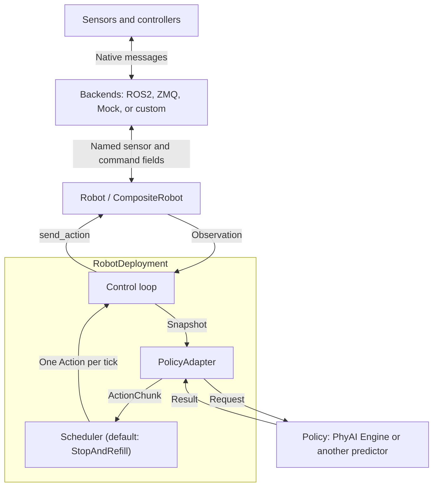

# phyai-robot

`phyai-robot` connects a policy to a robot: read sensor observations, turn them
into model inputs, and send the resulting actions at a configured control rate.
You can combine several device connections into one robot, reuse the same
deployment loop across robots, and replace the policy without rewriting device
communication.

The package runs independently of the PhyAI inference engine. Its core depends
on NumPy (plus an exception-group backport on Python 3.10) and includes a Mock backend for development without hardware.
ROS2 and ZMQ backends handle device communication; the application supplies the
message conversions and controller-specific stop behavior.

- [Design and interfaces](#design-and-interfaces)
- [Install and run](#install-and-run)
- [Understand the dual-arm example](#understand-the-dual-arm-example)
- [Control timing](#control-timing)
- [Connect your robot](#connect-your-robot)
- [Separate robot and inference environments](#separate-robot-and-inference-environments)

## Design and interfaces

Robot communication, model inference, and control timing have separate owners.
The robot exposes a fixed set of named sensor and command fields. The policy
accepts its own request type. Deployment connects them through an adapter and a
scheduler that owns the predicted actions.



The design follows four rules:

1. **Describe data independently of robot structure.** A joint vector, camera
   image, or force measurement is a named observation field. Names such as
   `left.q` and `camera.front.rgb` are identifiers, not paths through a part tree.
2. **Compose connections by field ownership.** Each backend owns a fixed subset
   of observation and action keys. One connection can serve several arms or
   sensors, and one robot can use several transports.
3. **Keep model conventions in the adapter.** Image preprocessing, normalization,
   checkpoint joint order, and conversion of predicted deltas to absolute targets
   belong to `PolicyAdapter`. Device codecs handle native device units and messages.
4. **Keep scheduling in deployment.** The robot sends one command at a time.
   A `Scheduler` decides when to predict and which command each tick sends;
   `RobotDeployment` owns the threads, robot I/O and control clock.

### Who implements what

| Interface | Contract | Your responsibility |
| --- | --- | --- |
| [`Robot`](src/phyai_robot/robot.py) | `observation_schema`, `action_schema`, `connect()`, `get_observation() -> Observation`, `send_action(Action)`, `stop()`, `close()` | Assemble `CompositeRobot` from backends, or implement this interface for an existing robot SDK. |
| [`Backend`](src/phyai_robot/backends/base.py) | `observation_keys`, `action_keys`, `connect()`, `read() -> Mapping[str, Sample]`, `write(Action)`, `stop()`, `close()` | Configure a supplied backend with codecs, or implement a new transport. |
| [`Policy[RequestT, ResultT]`](src/phyai_robot/policy.py) | `predict(RequestT) -> ResultT` | Supply a synchronous predictor. `EnginePolicy` delegates to an existing PhyAI engine's `step(request)`. |
| [`PolicyAdapter[RequestT, ResultT]`](src/phyai_robot/policy.py) | `to_request(Observation, InferenceContext) -> RequestT`, `to_actions(ResultT, Observation) -> ActionChunk` | Match this robot's fields to this model's input and output conventions. `VectorAdapter` covers the common "images + state vector -> action rows" case. |
| [`Scheduler`](src/phyai_robot/scheduling.py) | `wants_inference()`, `begin_inference()`, `add_chunk()`, `is_active()`, `action_at(tick_ns)` | Use `StopAndRefill`, or implement another strategy such as RTC. |
| [`RobotDeployment`](src/phyai_robot/deployment.py) | `run(max_steps=None)`, `stop()` | Choose the control rate and freshness budgets. |

These interfaces use Python protocols. Your classes only need to implement the
methods with matching signatures; they do not need to inherit a framework base
class. Request and result types are application-defined and remain linked through
the generic parameters of the policy, adapter, and deployment.

### Data contracts

The public types live in [`types.py`](src/phyai_robot/types.py). Both schemas are
fixed mappings from field names to `FeatureSpec` and are available before connection.

| Type | Fields and meaning |
| --- | --- |
| `FeatureSpec` | `shape`: one sample's dimensions; `dtype`: NumPy dtype name; optional `unit`, `names` for ordered vector components, and `frame` for spatial values. |
| `Sample` | `value`: a NumPy array in the declared layout; `received_at_ns`: the local `time.monotonic_ns()` value when its message arrived. |
| `Observation` | `samples`: a mapping from every observation key to its `Sample`. Fields may have different receive times. |
| `Action` | A mapping from every action key to a NumPy array for **one control tick**. |
| `ActionChunk` | `actions`: a nonempty tuple of complete `Action` mappings predicted from one observation. The scheduler decides how fast they are consumed. |

For example, `FeatureSpec((7,), "float32", unit="rad")` describes seven joint
positions. An RGB camera could use `FeatureSpec((480, 640, 3), "uint8")`; neither
field needs a parent body part. Shapes describe individual samples, without a
batch or trajectory dimension.

`CompositeRobot` validates keys, shapes, dtypes, and finite values. It does not
silently cast arrays, reorder joints, or convert units. The codecs must produce
values in the declared convention; `unit`, `names`, and `frame` document that
convention. A missing first sensor sample raises `ObservationNotReady` rather
than substituting zeros.

Snapshots and scheduled commands contain read-only arrays. Each array is copied
once, when a backend caches it or a chunk is accepted; later layers share the
frozen array instead of copying again. Copy an array before passing it to code
that modifies its input. A frozen dataclass alone does not freeze its contained
arrays, so a custom `Robot` must also detach its returned observations from
mutable receive buffers.

## Install and run

The standalone package supports Python 3.10+. PhyAI and root-workspace commands
require Python 3.12+. Run the examples below from the **PhyAI repository root**,
one directory above this README; keep a robot's interpreter compatible with its
native ROS/SDK installation.

### Try the Mock example without a GPU

This command creates an isolated environment for the local package and runs the
complete [dual-arm example](../examples/deployment/mock_loop.py):

```bash
uv run --no-project --isolated --with-editable ./phyai-robot \
  python examples/deployment/mock_loop.py --steps 30
```

Expected output:

```text
Completed 30 steps; both backends stopped.
```

The example uses simulated feedback and a small CPU policy. It needs no PhyAI
engine, model weights, ROS installation, or external robot service. This command
does not synchronize the workspace's `.venv`.

### Install with PhyAI

Select PhyAI's `deployment` extra to install the Robot core and Mock backend
alongside the engine:

```bash
uv sync --package phyai --extra deployment
uv run --no-sync python examples/deployment/mock_loop.py --steps 30
```

The `deployment` extra includes the Robot package's `zmq` (model RPC) and
`images` (Pillow) extras. For all workspace members, including the native
extension and optimizer, use `uv sync --all-packages --extra deployment`.

`--package` selects workspace packages; `--extra` enables named optional
dependencies on the selected packages. A plain root `uv sync` installs the root
project's declared dependencies, which do not include `phyai-robot`.

Workspace commands share the root `.venv`. `uv sync` removes packages outside
the selected dependency set by default, so include the packages and extras you
need on subsequent syncs. Use `--inexact` when intentionally adding to an existing
environment while preserving other installed packages. `uv run --no-sync` runs
against the environment you have already prepared. See uv's
[workspace](https://docs.astral.sh/uv/concepts/projects/workspaces/) and
[sync](https://docs.astral.sh/uv/concepts/projects/sync/) documentation for details.

### Install Robot without the engine

Create an independent environment with the native interpreter and install the
local package through `uv pip`. This bypasses the root workspace's Python 3.12
constraint and does not install the inference engine:

```bash
/usr/bin/python3 -m venv --without-pip --system-site-packages .venv-robot
uv pip install --python .venv-robot/bin/python './phyai-robot[zmq,images]'
.venv-robot/bin/python examples/deployment/mock_loop.py --steps 30
```

The `zmq` extra supports both inference RPC and the robot I/O ZMQ backend; the
`images` extra adds Pillow for model-size camera images. Omit them when only the
core/Mock/ROS backend is needed. `--system-site-packages` lets a
native robot environment see distribution-provided packages; source the relevant
ROS and message overlays in its shell. New packages are installed into the venv.

For the supported AgileX and Tianji deployments, use the matching dependency
lock, wheel and installer in the [environment guide](../examples/deployment/ROBOT_ENVIRONMENTS.md).
That guide also covers installing the same lightweight wheel in the model
process. Deployment examples/configs are distributed alongside the wheel; the
wheel alone does not contain their entry points.

Do not use root `uv sync --package phyai-robot` to install a Python 3.10 robot:
package selection does not remove the workspace's Python version constraint.
Always launch `.venv-robot/bin/python` explicitly after installation.

### Backend dependencies

| Backend | Installation |
| --- | --- |
| Mock | Included in the core package. |
| ZMQ | The `zmq` extra installs `pyzmq`. |
| ROS2 | Source a ROS2 installation providing `rclpy` and the required message packages for your Python interpreter. The declared `ros2` extra has no pip dependencies and does not install ROS middleware. |

Importing `phyai_robot` or its backend modules does not load PhyAI, Torch, ROS2,
or ZMQ. Transport SDKs are loaded when the corresponding backend connects.

## Understand the dual-arm example

[`examples/deployment/mock_loop.py`](../examples/deployment/mock_loop.py) is a complete
application with two seven-joint arms, one gripper per arm, and an independent RGB
camera. Start with its `main()` function to see the composition:

| Backend instance | Observation keys | Action keys |
| --- | --- | --- |
| `arm_backend` | `left.q`, `right.q`, `camera.front.rgb` | `left.target_q`, `right.target_q` |
| `gripper_backend` | `left.width`, `right.width` | `left.target_width`, `right.target_width` |

Both are `MockBackend` instances. Their `action_to_observation` mappings copy
commanded arm positions and gripper widths into subsequent feedback. Each read
generates a fresh simulated measurement. The camera stays an independent field;
the Mock backend does not simulate motion dynamics or rendering.

### 1. Assemble the robot

`CompositeRobot` receives the two backends, an observation schema, and an action
schema. Each arm vector has shape `(7,)`, dtype `float32`, and unit `rad`.
Each gripper width has shape `(1,)`, dtype `float32`, and unit `m`.
The camera has shape `(32, 32, 3)` and dtype `uint8`.

The constructor checks that backend key sets cover each schema exactly, with no
duplicate owners. When sending a complete action, it validates every field before
passing each backend only its owned command subset.

### 2. Adapt observations to the policy

The example defines this model-facing type:

```python
from typing import TypeAlias
from collections.abc import Mapping

import numpy as np
from numpy.typing import NDArray

# Keys: "left.target_q" and "right.target_q"; each array has shape (7,), in radians.
JointPositions: TypeAlias = Mapping[str, NDArray[np.float32]]
```

`DualArmAdapter.to_request(observation: Observation) -> JointPositions` extracts
copies of `left.q` and `right.q`, naming them with the target keys used by this
toy policy. The request contains current joint positions. The policy does not
consume the camera or gripper feedback, although they remain required robot
observations and are still checked for freshness.

### 3. Predict targets and build a chunk

`SmallStepPolicy.predict(request: JointPositions) -> JointPositions` adds
`0.01` radians to each input joint position and returns absolute arm targets.
`DualArmAdapter.to_actions(result, observation) -> ActionChunk` adds the two
gripper targets, both `0.02` meters, and repeats the complete action eight times.

For an initial joint reading of zero, the first chunk therefore holds each joint
at `0.01` radians and each gripper at `0.02` meters. Later predictions use newer
feedback. Each request/result mapping is a policy convention; the robot-facing
`Action` also includes all required gripper fields.

The adapter receives the **same observation used to create the request** when
converting the result. A model predicting joint deltas would add those deltas to
this snapshot. The example predicts absolute targets, so it needs no such addition.

### 4. Run the control loop

The example consumes targets with `StopAndRefill(action_hz=20)` and sends
commands with `DeploymentOptions(control_hz=20)`, so each of the eight targets
yields one command. With `--steps 30`, `run(max_steps=30)` connects the robot,
sends thirty commands, then stops and closes both backends.

The worker waits until the scheduler wants a prediction, reads an observation,
runs inference, and hands the chunk to the scheduler. The independent control
loop asks the scheduler for one command per tick. **With stop-and-refill it
sends nothing between chunks.** Observation and inference never run on the
control tick, and the next snapshot is not read until the previous chunk's last
interval and send have finished.

```mermaid
sequenceDiagram
    participant R as Robot
    participant L as Control thread
    participant Q as StopAndRefill scheduler
    participant W as Observation/policy worker
    participant P as Policy
    L->>R: connect()
    loop Until max_steps, stop(), or failure
        Note over L,W: Scheduler idle: control waits without sending
        W->>R: get_observation() under I/O lock
        R-->>W: Observation
        W->>W: adapter.to_request(snapshot, empty context)
        W->>P: predict(request)
        P-->>W: result
        W->>W: adapter.to_actions(result, same snapshot)
        W->>Q: Validate, detach, keep the execution_horizon prefix
        Note over L,W: Worker waits until the chunk has fully run
        loop At control_hz for this chunk
            L->>Q: action_at(tick): interpolate neighboring targets
            L->>R: send_action(action) under I/O lock
        end
        L->>Q: Final interval elapsed: scheduler idles; notify worker
    end
    L->>R: stop() and close()
```

A condition variable protects the scheduler. An I/O lock prevents
concurrent Robot reads, writes and shutdown; CompositeRobot needs no internal
synchronization changes. The application owns the policy and engine. Do not use
them or the robot concurrently while deployment owns their calls. Request
termination from another thread with `deployment.stop()`; `run()` performs the
hardware shutdown. Construct new robot/backend and deployment instances for
another run.

## Control timing

Two rates define execution:

- `StopAndRefill(action_hz=...)` is the rate at which predicted targets are
  consumed. With `execution_horizon` it sets how long each chunk runs:
  `execution_horizon / action_hz` seconds (20 targets at 25 Hz = 0.8 s).
- `DeploymentOptions(control_hz=...)` is the rate of `send_action` calls while
  a chunk runs. It only sets the density of linear interpolation between targets:
  at 25/200 Hz each source interval yields eight commands.

| `DeploymentOptions` | Default | Meaning |
| --- | --- | --- |
| `control_hz` | `200.0` | Command submission rate while the scheduler is active. |
| `max_sample_age_s` | `0.5` | Maximum receive age of every sensor when a snapshot is taken. |
| `observation_timeout_s` | `5.0` | Wait for complete, fresh sensors before each prediction; nothing is sent meanwhile. |
| `shutdown_timeout_s` | `2.0` | Wait for an in-flight prediction after hardware shutdown. |
| `max_control_lateness_s` | `0.01` | Maximum delay past a scheduled send; equality is allowed. |

| `StopAndRefill` | Default | Meaning |
| --- | --- | --- |
| `action_hz` | Required | Source targets consumed per second. |
| `execution_horizon` | `None` | Leading targets executed per prediction; `None` keeps all. A shorter prediction is an error. |
| `interpolate_keys` | `None` | Fields interpolated linearly; `None` selects every floating-point command field. Others hold the preceding target. |

### Stop-and-refill

The worker reads a fresh observation and predicts only when the previous chunk
has fully finished. The control loop then interpolates the retained prefix on a
new clock: target `i` is due at `i / action_hz`, and the final target is held
for one source interval, so the chunk covers `[0, N / action_hz)`. **Nothing is
sent while the worker observes and predicts.** The robot therefore pauses between
chunks for observation plus inference time.

A late wakeup within `max_control_lateness_s` skips old ticks and sends the
latest due target, never a catch-up burst; larger lateness ends the run. Timing
errors report the lateness, wakeup delay, I/O-lock wait, preparation time and
previous send duration. `max_steps` counts actual sends. Interpolation stays
between adjacent targets; it is not a velocity limiter or pose interpolator, and
the first target of each chunk is sent without a transition from the previous
command.

### Custom strategies

`RobotDeployment` calls its scheduler under one lock, from two threads:

| Call | Thread | Purpose |
| --- | --- | --- |
| `bind(action_schema)` | Construction | Validate settings against the command fields. |
| `wants_inference()` | Worker | Take a snapshot and predict now? |
| `begin_inference(now_ns) -> InferenceContext` | Worker | Record the snapshot time; return the targets that will still run during inference. |
| `check(chunk)` / `add_chunk(chunk, context, now_ns)` | Worker | Validate, then accept the prediction made for that context. |
| `is_active()` | Control | Can `action_at` produce commands? |
| `action_at(tick_ns)` | Control | Command for this tick, or `None` to go idle. |

The adapter receives the `InferenceContext` in `to_request`. Real-time chunking
fits this protocol: keep `wants_inference()` true while a chunk still executes,
pass the pending targets to a guided model through the context, and merge the
new chunk in `add_chunk` so `action_at` never returns `None` between chunks.
The control loop, I/O lock and shutdown order stay unchanged.

Choose freshness budgets that include sensor age and model latency. Sensors
are **not reread during execution**. Receive time is not capture time and cannot
establish sensor synchronization. Device-side limits and watchdogs remain
necessary, especially because no host commands arrive during inference.

A blocked predictor cannot be forcibly cancelled. If it exceeds the shutdown
budget, `run()` reports the timeout after stopping hardware and discards the
worker's eventual result. Keep its engine alive until prediction has returned.

## Connect your robot

Start from the Mock example and replace one boundary at a time:

1. Define observation and action schemas in your robot's physical units and
   joint order. Include every required sensor, even if a particular policy does
   not consume it.
2. Configure backends for those fields. Reuse ROS2 or ZMQ where their transport
   model matches your controller; implement `Backend` for another protocol.
3. Assemble `CompositeRobot`, optionally supplying `action_guard(Action) -> None`
   to reject commands outside static physical limits before any writes. This
   callback must not mutate commands or perform I/O.
4. Implement the adapter for your policy checkpoint and choose deployment timing.
   The policy itself only needs `predict(request)`; `EnginePolicy(engine)` can
   wrap an existing PhyAI engine while your adapter handles its concrete types.

### Reuse the supplied backends

| Backend | Configure | Behavior |
| --- | --- | --- |
| [`MockBackend`](src/phyai_robot/backends/mock/backend.py) | `initial_values`, `action_to_observation` | Copies commands into mapped feedback; useful for testing schemas, adapters, and control logic. |
| [`Ros2Backend`](src/phyai_robot/backends/ros2/backend.py) | Field/group `RosObservation(topic, message_type, decode, qos)` and `RosCommand(topic, message_type, encode, qos)`; `on_stop(backend)` for command backends | Subscribes, publishes and calls services using an owned node, context, and executor on one worker thread. |
| [`ZmqBackend`](src/phyai_robot/backends/zmq/backend.py) | PUB/REP peer endpoints, owned keys, `decode_observation`, `encode_action`, `encode_stop`, and `check_reply` | Receives observations through SUB and submits commands through REQ/REP. Application codecs define the multipart byte format and validate acceptance replies. |

A string binding key maps one NumPy array to one ROS message. A tuple key maps
several named fields to one message: its decoder returns a dictionary with
exactly those keys, and its encoder receives that dictionary. Fields from one
received message share a timestamp and enter the cache together. Grouped
commands publish in binding declaration order; existing single-field bindings
retain the supplied action order. Every encoder completes before any message
is published. Publishing multiple topics is not atomic.

QoS can be a depth, an rclpy `QoSProfile`, or one of the names `"sensor_data"`,
`"reliable"` and `"best_effort"`, so robot configs can set it from YAML. It must
be compatible with the actual peer: a reliable subscription never matches a
best-effort publisher.

Set `RosCommand(stamp=True)` to fill `header.stamp` from the backend's ROS clock
immediately before publication. `domain_id=None` uses the native ROS environment;
an explicit domain applies to that backend's context. A decoder failure normally
ends the worker. `RosObservation(recover_on_next_message=True)` instead makes
`read()` report the failure until the next valid message on that binding, without
changing other bindings' error state.

Decoders preserve the schema's units, joint order and dtype. The pure helpers
in `backends.ros2.codecs` never import ROS: `decode_rgb_image` (8-bit RGB/BGR/
RGBA/BGRA/mono with row padding), `decode_nv12_image` (requires OpenCV; there is
no silent fallback with different colors), `decode_joint_positions` (JointState
positions in a requested name order), `decode_pose` and `decode_wrench`.
`phyai_robot.images.resize_with_pad` (the `images` extra) letterboxes RGB to the
model's square size with the same PIL arithmetic as PhyAI's pi0.5 processor, so
decoders can cache small images. `image_backends(...)` builds one backend per
camera so slow image decoding never delays another camera or a command worker.
Keep robot-specific joint/gripper layouts in the deployment bindings.

Multi-megabyte raw images often lose UDP fragments in DDS. When a camera
pipeline also publishes H.264 as `sensor_msgs/CompressedImage`, decode that
stream instead with `backends.ros2.video` (the `video` extra, PyAV).
`H264Decoder` decodes every access unit in order and uses the slice-header
`frame_num` to detect a lost reference picture. It returns `None` from that
loss until the next IDR, because FFmpeg does not flag such damaged frames. A
decoder that returns `None` caches nothing for that message, so the previous
sample keeps aging and the deployment's freshness check pauses inference
instead of using a damaged image. `MosaicDecoder` splits a grid of cameras
into named tiles from one frame; bind it to a tuple key so the tiles share a
receive timestamp.

`call_service(type, name, request, timeout_s=...)` runs a ROS service call on the
backend's worker with one end-to-end deadline and raises on `success == False`.
The `on_stop` callback receives the backend, runs on its worker and is bounded
by `stop_timeout_s` (default: `io_timeout_s`), so a stop that calls a controller
service can take longer than one command publication. [Offline ROS backend tests](tests/backends/test_ros2.py)
exercise the public contract with in-memory contexts and topics; real middleware
and QoS interoperability still require hardware integration testing.

For ZMQ, define an explicit stop message and check the reply from your device.
The backend does not choose a serialization format or automatically replay failed
commands. A timed-out REQ socket is replaced before the stop attempt. The
[local ZMQ tests](tests/backends/test_zmq.py) include a small peer and JSON codecs
that demonstrate the required exchange.

### Mix transports or add a new one

For ROS-controlled arms and CAN-controlled grippers, keep the example's field
ownership split: a `Ros2Backend` owns the arm fields and a custom CAN backend
owns the gripper fields. `CompositeRobot` merges their observations and routes
each action subset to its owner. A camera may belong to either connection or to
its own backend. CAN is not a bundled backend.

Implement the public [`Backend` protocol](src/phyai_robot/backends/base.py) for
the CAN session. `read()` must return cached, detached samples without waiting
for the next frame, preserving each field's local receive timestamp. It can
return incomplete data during startup. Bound connection and command waits,
surface receive-worker errors, and make stop/close tolerate repeated calls and
partial initialization. The shared `_threaded.py` helper is private to the
supplied transports; custom backends need not inherit it.

Successful `send_action()` means submission or transport acceptance, not physical
motion completion. Writes across independent connections cannot be atomic or
rolled back: if a later write fails, `CompositeRobot` attempts to stop all opened
backends. Device controllers remain responsible for their motion limits and
watchdogs when the host or communication link is unavailable.

## Run the package tests

Run the Mock, deployment, validation, and local ZMQ tests in an isolated environment:

```bash
uv run --no-project --isolated --with-editable './phyai-robot[zmq,images]' --with pytest \
  python -m pytest -c phyai-robot/pyproject.toml --confcutdir=phyai-robot phyai-robot/tests
```

The explicit pytest configuration and `--confcutdir` keep this package's tests
independent of the repository's CUDA test bootstrap. They need no GPU or physical
robot. See the [example](../examples/deployment/mock_loop.py) for the complete application
and the [source directory](src/phyai_robot) for the typed interfaces and implementations.

## Separate robot and inference environments

The standalone package supports Python >=3.10; the PhyAI workspace requires
Python >=3.12. A robot can run its native ROS/SDK Python while the model runs in
a separate environment and process. Install the `zmq` extra for RPC; importing
`phyai_robot.remote` loads neither ZMQ nor Torch.

The boundary is the model's own contract. `PolicyServer` advertises a
`PolicySpec`: named input arrays (for example `image.<camera>` and `state`) and
output arrays (`actions` with shape `(horizon, action_dim)`), plus metadata such
as the image size. The server performs checkpoint preprocessing, inference and
postprocessing; it knows nothing about robot fields, units or calibration. The
robot client's adapter maps its observation to those inputs and the action rows
to complete commands, so one model server can drive different robots.

`remote.run_remote` is the shared client lifecycle: read the spec, build the
robot and adapter, check that the adapter's request schema equals the model's
inputs, reserve a run, connect, run and discard one warmup, check sensor
freshness again, call the embodiment's `activate()` hook, then run
`RobotDeployment`. Cleanup always stops and closes the robot before releasing
the run. `RemotePolicy` reuses one REQ socket and never retries a request.

One run owns the server at a time. A run that sends no request for
`lease_timeout_s` (default 60 s) is released, so a crashed or disconnected client
cannot keep the model busy. The protocol has no authentication or encryption;
bind loopback or use a trusted network.

See [deployment environments](../examples/deployment/ROBOT_ENVIRONMENTS.md) for
the AgileX and Tianji examples, host profiles and startup commands.
