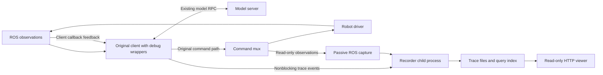
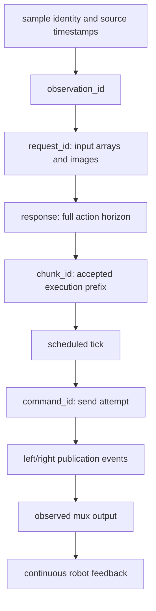
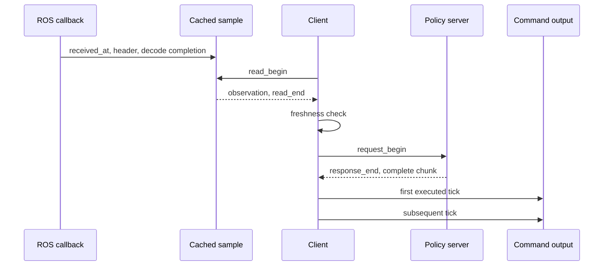

# Trace capture and replay design

## Scope

The tool explains the path from an observation used by the client to a policy
result, a scheduled command, a mux-selected output, and measured feedback. It
lives under `tools/phyai_debug`. Production files in `phyai_robot`, the model
server, and robot drivers are not edited for tracing.

The launcher composes wrappers around existing interfaces and installs narrowly
scoped diagnostic probes where a public interface drops information. The same
native `run_remote()` owns warmup, controller activation, deployment, and
shutdown. The debug tool does not maintain another control loop.

The first implementation targets the current Tianji `StopAndRefill` client.
Unknown contracts must fail compatibility checks before robot connection.
Recording an RTC implementation requires a separately verified scheduler
adapter; an RTC label must not be inferred from a checkpoint name.

## Processes and ownership



| Owner | Work |
| --- | --- |
| Original client | Locks, freshness validation, policy calls, interpolation, command publication, stopping |
| Debug wrappers and probes | Timestamp and correlate the values actually crossing those operations |
| Passive ROS capture | Observe final mux commands and control-source changes; client probes retain feedback and compressed video |
| Recorder child | Encode PNGs, serialize events, write files, update the index and completion state |
| Viewer | Query recorded intervals and render curves, RGB, and FK poses |

The writer does not publish ROS messages, invoke controller services, or load a
model. The viewer does not import the controller or offer control endpoints.
Playback means advancing a browser cursor, not replaying commands to hardware.

## Collection points

| Collection point | Evidence |
| --- | --- |
| Robot observation read | Read start/end, returned samples and their exact callback timestamps, read failures |
| Adapter request construction | The exact model state and RGB arrays; original sample association |
| Policy warmup and predict | Request/result, RPC IDs where available, local duration, exceptions; warmup marked as discarded |
| Adapter result conversion | Original policy result and robot command fields after normal conversion and gripper clipping |
| Scheduler chunk submission | Chunk identity, retained horizon, prediction source |
| Scheduler action lookup | Requested tick time and the actual interpolated target returned |
| Robot send | Command identity, call entry/return, failure |
| Backend callback and cache | Original header, callback time, decode completion, accepted cache update |
| Backend publication | Per-topic encoded message, header, publish timing and outcome |
| Passive subscriptions | Independently received mux output, DAgger events and input modes |

The private probes exist only for data unavailable through a public interface.
Their compatibility checks and cleanup belong together. They must forward each
call exactly once, preserve exceptions, restore patched objects on exit, and
never retry a failed inference or robot command.

An independent subscriber's timestamp is its own arrival time. It cannot
substitute for the client callback timestamp. Likewise, copying a nearby video
frame cannot establish which pixels the client consumed.

## Identity and ordering



The first part of this chain is deterministic within the instrumented client.
ROS does not provide an end-to-end command acknowledgement in these topic
types. Mux output and feedback are time-aligned observations, not fabricated
acknowledgements of a `command_id`. Where matching is ambiguous, the trace
preserves that ambiguity.

The recorder assigns event sequence numbers. A timestamp captures the operation
time before asynchronous writing; a writer timestamp would measure disk delay.
The database may receive events from different threads out of timestamp order.
Queries sort and paginate by explicit fields, never by filesystem modification
time.

Warmup, valid predictions, rejected chunks, cancelled requests, and
unexecuted action tails remain distinguishable.

## Clock model and freshness

Record local monotonic nanoseconds for intervals. Preserve a monotonic/wall
clock anchor in the manifest for human-readable times. Keep source ROS header
timestamps in a separate field with their domain and availability.



For a field with callback time `r`:

```text
read_age = read_end - r
request_age = request_begin - r
execution_age = command_send_time - r
```

The actual freshness decision uses the clock read inside the original
freshness function. Record its timestamp and outcome when available rather
than substituting an adjacent wrapper timestamp.

The camera callback starts before decode. Its callback-relative age therefore
includes decode time. Sensor transport delay before that callback is not
included. A ROS header may represent publication time rather than hardware
sampling time; it is not labeled as capture latency without verification.

The joint-feedback message supplies both arms with one callback timestamp.
Left and right gripper feedback arrive independently and have no header in
the current `Float32MultiArray` type. A single timestamp on the concatenated
16D state would hide these differences.

The current freshness gate runs before inference. It does not enforce the same
maximum age throughout action execution. The viewer distinguishes gate
violations from a naturally increasing execution-age curve.

## Actions, interpolation, and comparison

Keep these arrays separate:

1. Full policy RPC output.
2. Adapter-produced robot action fields, including any clipping.
3. Scheduler target at each execution tick.
4. Per-topic client publications.
5. Mux output observed on the driver's input topic.
6. Measured robot feedback.

For an H50 result with execution horizon 25, all 50 predictions are retained
in the trace, while only the first 25 are marked as scheduled. `StopAndRefill`
starts its trajectory clock on the first `action_at()` call. Plotting those
targets against request-send time would create a false tracking lag.

The current server normally postprocesses normalized outputs into physical
targets before returning them. Trace visualization does not repeat
normalization or delta restoration. Configuration snapshots document those
conventions; checkpoint filenames do not.

Tracking error uses physically comparable quantities, the correct controller
source, and an explicit time alignment. Command publication is normally
sample-and-hold; raw feedback sample times remain visible. Gaps are not
silently bridged. Offline interpolation, when displayed, is a visualization
choice and does not replace the raw samples.

During DAgger takeover, the user/VLA topic may still carry predictions while
the mux selects teleoperation. Such intervals are marked by mode events and
must not be counted as VLA tracking failures.

## Storage and bounded work

Each output is a new directory. An existing trace is never overwritten.
Numeric events and image work have separate bounded queues. The client does
no image encoding, JSON formatting, filesystem flush, or network upload on
the control path.

The writer stores queryable numeric events in SQLite and exact request images
as PNG. Compressed camera packets retain payload boundaries and timestamps;
they are not decoded again just for recording. The manifest records format
version, clocks, schemas, configuration, asset identity, counts, and recorder
health.

A queue overflow, writer crash, disk-full error, or unflushed exit makes the
recording incomplete. The failure is visible in its metadata; it does not
replace the client's control exception or block a command until disk I/O
finishes. This choice preserves deployment behavior but does not promise a
complete trace under arbitrary resource failure.

On `Ctrl+C`, the native deployment cleanup stops the robot first. Recorder
shutdown then waits for a bounded flush. A sudden kill can leave a readable
partial trace. An interrupted session must never gain a successful completion
marker merely because some files exist.

## Read-only viewer

The HTTP viewer binds to loopback by default. It serves only a selected trace
and bundled frontend resources. Paths are validated, symlink escapes are
rejected, query sizes are bounded, and no mutation/control endpoint exists.

Low-rate request and lifecycle events populate the overview. High-rate
feedback and command events are fetched for the visible time range. A query
that reaches its limit reports truncation and a continuation cursor; the
frontend must not treat a capped response as a complete recording.

All panels share one playhead. Request images are step-held and labeled as
model input snapshots. Continuous video is separate context. The full chunk
inspector can select an unexecuted prediction without pretending it has a
corresponding future robot state.

## Robot geometry

The asset snapshot contains the URDF, referenced mesh files, and hashes.
Runtime paths and hostnames remain local configuration, not committed
defaults. Copying validates resource paths; package URIs resolve only inside
the selected asset tree.

Two instances of the same URDF share geometry but have independent joint
values and materials. Actual feedback is blue; target pose is orange and
translucent or wireframe. Line styles and labels supplement color.

The offline renderer disables joint-limit clamping so it does not hide a
recorded out-of-range action, then marks the violation. This setting does not
affect hardware. FK uses the URDF tree and does not simulate contacts,
compliance, inertia, or tracking dynamics. A fixed tool frame is not evidence
that its physical calibration is exact.

The current console model has 14 arm joints and no movable gripper joints.
Gripper curves remain available without inventing finger geometry.

## Validation contract

Tests must cover immutable input snapshots, event association, independent
queue limits, writer failure visibility, partial recordings, bounded queries,
path traversal, and asset escapes. Mock deployment compares instrumented and
ordinary calls, values, ordering, exception propagation, and cleanup.

Viewer checks use synthetic traces and saved fixtures. They exercise
timeline seeking, request/action selection, image loading, joint plots,
mode/gap markers, and asset loading. They do not call a controller.

An offline timing measurement can quantify recording overhead. It cannot
guarantee the live robot's 200 Hz deadline under camera decode, inference,
and competing workloads. Keep the existing deadline and freshness limits
unchanged for supervised acceptance.
